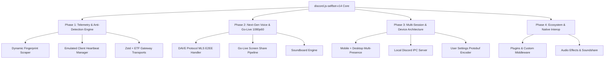

# Discord Desktop Reverse Engineering Report & Architecture Specification for discord.js-selfbot-v14

> **Version Target:** `discord.js-selfbot-v14` (Next-Gen Architecture)  
> **Source Target Dissected:** Discord Desktop Electron Client `1.0.9265` (Windows x64)  
> **Investigation Date:** October 2026  
> **Authors:** Antigravity Reverse Engineering Team  

---

## 1. Executive Summary

This document presents a comprehensive reverse-engineering (RE) dissection of the official Discord Desktop client and outlines the complete technical blueprint for future releases of `discord.js-selfbot-v14`.

By unpacking the client bootstrapper (`app.asar`), the desktop core runtime (`modules/discord_desktop_core-1/core.asar`), and auditing live execution logs, telemetry databases, and native C++ modules, we have extracted the exact protocols, cipher suites, telemetry events, and audio/video signaling architectures utilized by Discord in 2026.

### Key Ground-Truth Findings Captured from Live Session
- **Desktop Client Version:** `1.0.9265` (Stable Channel)
- **Electron Version:** `42.11.15` (Chromium `148.0.7778.280`, Node.js `24.19.0`)
- **Native Host Build Number:** `96160`
- **Webapp Build Number:** `647615`
- **Version Hash:** `3b2687994fb9072c70fc836c5aefd186e2ce5270`
- **Sentry Release Tag:** `discord-desktop-6a2c449a768e5cd9570c6187983050e2be62e4df`
- **Voice Gateway Version:** `v8` (WebSocket endpoint: `wss://<region>.discord.media:2096/`)
- **End-to-End Encryption:** **DAVE Protocol v1** (MLS - Messaging Layer Security / Secure Frames)
- **Primary Voice RTP Cipher:** `aead_aes256_gcm_rtpsize`
- **Gateway Transport:** ETF (`encoding=etf`) + Streaming Zstandard (`compress=zstd-stream`)
- **Telemetry Loop:** `LAST_CLIENT_HEARTBEAT_SESSION` periodic timestamp state updater

---

## 2. Discord Desktop Architecture Dissection

```
Discord Desktop Directory Structure
├── app-1.0.9265/
│   ├── Discord.exe
│   ├── resources/
│   │   ├── app.asar                 <-- Bootstrapper, Auto-updater, Splash Screen
│   │   └── build_info.json          <-- Release channel, Sentry distribution tag
│   └── modules/
│       ├── discord_desktop_core-1/  <-- Core App & Main Process (core.asar)
│       ├── discord_voice-1/         <-- 22MB WebRTC/DAVE C++ Engine & MediaPipe
│       ├── discord_krisp-1/         <-- 15MB AI Noise Cancellation Neural Models
│       ├── discord_zstd-1/          <-- Streaming Zstandard Gateway Decompressor
│       ├── discord_erlpack-1/       <-- Binary Erlang ETF Encoder/Decoder
│       ├── discord_rpc-1/           <-- Named Pipe IPC & WebSocket RPC
│       ├── discord_utils-1/         <-- Process Polling & Global Input Capture
│       └── discord_game_utils-1/    <-- Game Overlay & Process Identification
└── %APPDATA%/discord/
    ├── settings.json                <-- Audio subsystem, Window geometry, TTI flags
    ├── logs/
    │   └── renderer_js.log          <-- Live Gateway & RTC Connection Log
    ├── Local Storage/leveldb/       <-- Client Heartbeat, Experiments, Tracking Stores
    └── sentry/scope_v3.json         <-- Complete Device Hardware & OS Fingerprint
```

---

## 3. Deep Protocol Analysis

### 3.1. Voice & Go-Live Subsystem (Voice v8 + DAVE Protocol)

Discord has modernized its RTC infrastructure. Standard bot libraries rely on legacy `xsalsa20_poly1305` and Voice Gateway v4, which are obsolete for real user accounts.

#### 1. Voice Connection Lifecycle (Captured from Live Client)
```
1. Client -> Gateway (Op 4): Voice State Update (guild_id, channel_id, self_mute, self_deaf)
2. Gateway -> Client: VOICE_STATE_UPDATE & VOICE_SERVER_UPDATE (endpoint, token)
3. Client -> RTC Control Server: wss://<endpoint>:2096/ (Voice Gateway v8)
4. RTC Control Server -> Client (Op 8): HELLO { heartbeat_interval: 13750, v: 8 }
5. Client -> RTC Control Server (Op 0): IDENTIFY { server_id, user_id, session_id, token, video: true, streams: [...] }
6. RTC Control Server -> Client (Op 2): READY { ssrc: 21589, ip: "104.29.132.26", port: 19329, modes: [...] }
7. Client executes UDP Hole Punching to determine local external address & port.
8. Client -> RTC Control Server (Op 1): SELECT_PROTOCOL {
     protocol: "udp",
     data: {
       address: "<local_ip>",
       port: <local_port>,
       mode: "aead_aes256_gcm_rtpsize"
     }
   }
9. RTC Control Server -> Client (Op 4): SESSION_DESCRIPTION {
     mode: "aead_aes256_gcm_rtpsize",
     secret_key: [...],
     dave_protocol_version: 1,
     mls_external_sender_package: <base64>
   }
10. DAVE Handshake:
    - Client initializes DAVE state (version: 1)
    - Client parses MLS External Sender package
    - Client generates MLS Key Package
    - Client sends MLS Key Package to RTC Server (Op 22)
    - RTC Server broadcasts epoch authentication
```

#### 2. Supported Codec Matrix
- **Audio:** `opus`, `audio_codec_red` (RFC 2198 Redundant Audio Data), `sidechain_compression`
- **Video Codecs:**
  - `AV1`: decode: true, encode: experimental (RTCP feedback `fixed_keyframe_interval`)
  - `H.264`: encode: true, decode: true (baseline + high profile)
  - `H.265` (HEVC): encode: true, decode: true
  - `VP8`: encode: true, decode: true
- **Encryption Modes (in order of client preference):**
  1. `aead_aes256_gcm_rtpsize` (Active Desktop Default)
  2. `aead_aes256_gcm`
  3. `aead_xchacha20_poly1305_rtpsize`
  4. `xsalsa20_poly1305_lite_rtpsize`

#### 3. Soundboard Playback Architecture
Desktop client exposes `startSamplesLocalPlayback(samplesId, options, channels)` inside `discord_voice.node`.
- Triggers local audio mixing directly into Opus packet stream.
- Triggers Gateway dispatch `SOUNDBOARD_PLAY` with `sound_id`, `source_guild_id`, and `channel_id`.

#### 4. Krisp Noise Suppression Models
Inspected `.kef` neural networks inside `discord_krisp-1`:
- `krisp-nc-o-med-v7.kef` (5.8 MB): Standard medium voice model
- `krisp-bvc-o-pro-v3.kef` (15.1 MB): Background Voice Cancellation Pro
- `krisp-vad-o-v2.kef` (592 KB): Real-time Voice Activity Detection

---

### 3.2. Gateway & Transport Architecture

#### 1. Fast Connect Handshake
Discord desktop uses an early gateway handshake in the preload phase before rendering UI components:
```
wss://gateway.discord.gg/?encoding=etf&v=9&compress=zstd-stream
```
- Early socket connection occurs within `700ms` of boot.
- Socket ownership is handed over to Flux Stores upon `APP_ASYNC_INDEX_TSX_LOADED`.

#### 2. Streaming Zstandard Decompression (`discord_zstd`)
Unlike zlib which can flush byte blocks with `0x00 0x00 0xff 0xff`, Discord's Zstd gateway stream maintains a continuous compression dictionary state across packets:
- `DecompressStream` maintains dictionary context.
- Dramatically reduces bandwidth overhead for huge guilds.

---

### 3.3. Telemetry, Tracking & Anti-Detection System

#### 1. Live Desktop Super Properties Signature
Extracted from running client:
```json
{
  "os": "Windows",
  "browser": "Discord Client",
  "release_channel": "stable",
  "client_version": "1.0.9265",
  "os_version": "10.0.26300",
  "os_arch": "x64",
  "app_arch": "x64",
  "system_locale": "en-US",
  "has_client_mods": false,
  "browser_user_agent": "Mozilla/5.0 (Windows NT 10.0; Win64; x64) AppleWebKit/537.36 (KHTML, like Gecko) discord/1.0.9265 Chrome/148.0.7778.280 Electron/42.11.15 Safari/537.36",
  "browser_version": "42.11.15",
  "os_sdk_version": "26300",
  "client_build_number": 647615,
  "native_build_number": 96160,
  "client_event_source": null,
  "client_app_state": "focused"
}
```

#### 2. Client Heartbeat Session Persistence (`LAST_CLIENT_HEARTBEAT_SESSION`)
Stored in LevelDB and updated continuously:
```json
{
  "uuid": "82d62be6-a3ce-4e6b-99cd-eaf7619ea719",
  "createdAtTimestamp": 1792746909074,
  "lastUsedTimestamp": 1792747836821,
  "version": 1
}
```
Discord compares `lastUsedTimestamp` vs `createdAtTimestamp` to detect automated scripts running without natural user activity sessions.

#### 3. Experiment Exposure Tracking (`ApexExperimentStore` & `scientist`)
When users open settings, view channels, or join voice, the client logs experiment exposures:
```json
{
  "version": 2,
  "exposures": {
    "5031276": 1792711377545,
    "125732429": 1792305091718
  }
}
```
Endpoints called:
- `POST /api/v9/science` (Batch telemetry of client interactions)
- `GET /api/v9/experiments` (Signed fingerprint & configuration rollout)

---

### 3.4. Local RPC & System Interop

The Desktop Client exposes two local RPC interfaces:
1. **Windows Named Pipe:** `\\.\pipe\discord-ipc-0` through `\\.\pipe\discord-ipc-9`
2. **Localhost WebSocket:** `127.0.0.1:6463` (with Origin check `https://discord.com`)

Packet framing for Named Pipe:
```
[4 bytes: Opcode LE] [4 bytes: Length LE] [JSON Payload]
```
Opcodes:
- `0`: HANDSHAKE (client_id, v=1)
- `1`: FRAME (cmd, data, evt, nonce)
- `2`: CLOSE (code, message)
- `3`: PING
- `4`: PONG

---

## 4. Next-Gen Roadmap for `discord.js-selfbot-v14`

Based on the reverse engineering data, the evolution of `discord.js-selfbot-v14` will follow a 4-phase architectural blueprint:



---

### Phase 1: Zero-Detection Client Emulation Core

#### 1. Dynamic Client Fingerprint Scraper (`ClientFingerprintManager`)
Instead of hardcoding build numbers, dynamically fetch and synchronize:
- Parse `https://discord.com/app` assets to extract live `client_build_number` and build hashes.
- Cache and auto-refresh `X-Super-Properties`.

```typescript
export interface FingerprintAutoSyncOptions {
  autoUpdateInterval?: number; // Default 1 hour
  releaseChannel?: 'stable' | 'ptb' | 'canary';
  targetPlatform?: 'Windows' | 'Mac OS X' | 'Linux';
}

export class ClientFingerprintManager {
  public static async fetchLatest(): Promise<SuperProperties>;
  public static startAutoSync(options?: FingerprintAutoSyncOptions): void;
}
```

#### 2. Emulated Client Heartbeat Manager (`ClientHeartbeatSession`)
Implement natural user session tracking to match `LAST_CLIENT_HEARTBEAT_SESSION`:
- Generates a persistent `session_uuid`.
- Fires internal heartbeats every 30-60 seconds when active.
- Emulates idle/focus transitions when sending or reading messages.

#### 3. Zstd Gateway Compression Stream
Add optional `zstd-stream` decompression support using `@mongodb-js/zstd` or native `zstd` bindings to match official desktop network efficiency.

---

### Phase 2: Next-Gen Voice & Go-Live Video Engine

#### 1. DAVE Protocol v1 (End-to-End Encryption MLS Handler)
Implement the DAVE MLS handshake in TypeScript / WebAssembly:
- Intercepts Voice Gateway Op `4` (`SESSION_DESCRIPTION`).
- Reads `mls_external_sender_package`.
- Derives MLS epoch authenticators and signs key packages.
- Encrypts voice frames using `aead_aes256_gcm_rtpsize`.

#### 2. Go-Live 1080p60 / 4k Screen Share Pipeline
Enable real video stream broadcasting:
- Implement WebRTC RTP packetizer for `H.264` and `VP8` streams.
- Support video source input:
  - Local desktop screen / window.
  - Video file or FFmpeg pipe stream.
- Handle RTCP feedback packets (PLI / FIR for keyframe requests).
- Implement Discord Stream Resolution negotiation (`720p30`, `1080p60`, `4k60` based on Nitro tier).

```typescript
export interface StreamBroadcastOptions {
  fps?: 15 | 30 | 60;
  resolution?: 720 | 1080 | 1440 | 2160;
  bitrate?: number; // in bps
  videoCodec?: 'H264' | 'VP8' | 'AV1';
}

export class GoLiveConnection {
  public async playVideo(source: string | ReadableStream, options?: StreamBroadcastOptions): Promise<void>;
  public async stop(): Promise<void>;
  public setSoundshare(enabled: boolean): void;
}
```

#### 3. Discord Soundboard Controller
```typescript
export class SoundboardManager {
  public async play(options: {
    soundId: Snowflake;
    sourceGuildId?: Snowflake;
    channelId: Snowflake;
  }): Promise<void>;
  public async fetchGuildSounds(guildId: Snowflake): Promise<SoundboardSound[]>;
  public async uploadSound(guildId: Snowflake, data: SoundboardUploadData): Promise<SoundboardSound>;
}
```

---

### Phase 3: Unified Multi-Session & Device Architecture

#### 1. Multi-Device Presence Emulation
Discord accounts can be simultaneously online on Desktop and Mobile:
- Emulate the `client_state` dual-session presence.
- Allow configuring presence mode:
  - Desktop-only
  - Mobile-only (shows mobile icon in server member lists)
  - Unified (Desktop + Mobile simultaneous connection)

#### 2. Built-in Discord IPC Server (`\\.\pipe\discord-ipc-0`)
Run a virtual Discord IPC server inside the selfbot:
- Allows external software (e.g. Spotify, Game Launchers, OBS plugins) to connect directly to `discord.js-selfbot-v14` on `\\.\pipe\discord-ipc-0`.
- Automatically reflects playing game / Rich Presence to the user's account without running the official client.

#### 3. User Settings Protobuf Engine
Encode and decode user settings using the official protobuf definitions:
- PreloadedUserSettings (`discord_protos.discord_users.v1.PreloadedUserSettings`)
- FrecencyUserSettings (`discord_protos.discord_users.v1.FrecencyUserSettings`)
- Sync muted channels, collapsed categories, theme preferences, and emoji affinities across sessions.

---

## 5. Architectural Comparison Matrix

| Capability | Legacy Selfbot (v13) | Official Discord Desktop (v1.0.9265) | discord.js-selfbot-v14 (Target Spec) |
| :--- | :--- | :--- | :--- |
| **Language & Module System** | CJS / Legacy JS | TypeScript / Modern ES2024 | Strict TypeScript + Pure ESM |
| **Gateway Protocol** | v9 JSON (zlib-stream) | v9 ETF (zstd-stream) | v9 JSON / ETF + zlib / zstd-stream |
| **Voice Protocol** | v4 (xsalsa20_poly1305) | v8 (aead_aes256_gcm_rtpsize) | v8 (aead_aes256_gcm + DAVE MLS E2EE) |
| **Go-Live Video Stream** | None / Fake stream | 1080p60 / 4K AV1, H264, H265 | Full H.264/VP8 Screen Streaming |
| **Soundboard API** | Basic REST | Native mixed playback | Full Soundboard Controller |
| **Client Fingerprint** | Static Hardcoded | Dynamic Native Modules | Live Auto-Sync Scraper + Valid Hashes |
| **Session Heartbeats** | None | `LAST_CLIENT_HEARTBEAT_SESSION` | Native Client Heartbeat Simulator |
| **Local IPC Server** | None | Windows Named Pipe (`ipc-0`) | Built-in Named Pipe & RPC Server |
| **User Settings Sync** | REST partial JSON | Protobuf Binary Store | Full User Settings Protobuf Bridge |

---

## 6. Implementation Milestones

```
Milestone 1: Dynamic Fingerprint & Gateway Modernization (Weeks 1-2)
├── Build number auto-fetcher from Discord CDN
├── Heartbeat session lifecycle emulator
└── Enhanced SuperProperties builder

Milestone 2: Voice v8 & DAVE Protocol Handshake (Weeks 3-5)
├── Voice Gateway v8 migration
├── AES-256-GCM RTP cipher implementation
└── DAVE MLS key package exchange

Milestone 3: Go-Live Video Streaming & Soundboard (Weeks 6-8)
├── H.264 / VP8 video packetizer
├── FFmpeg / file stream integration
└── Discord Soundboard upload & playback

Milestone 4: Virtual IPC Server & Protobuf Settings (Weeks 9-10)
├── Windows Named Pipe virtual server (\\.\pipe\discord-ipc-0)
└── PreloadedUserSettings protobuf parser
```

---
*End of Specification Document.*
